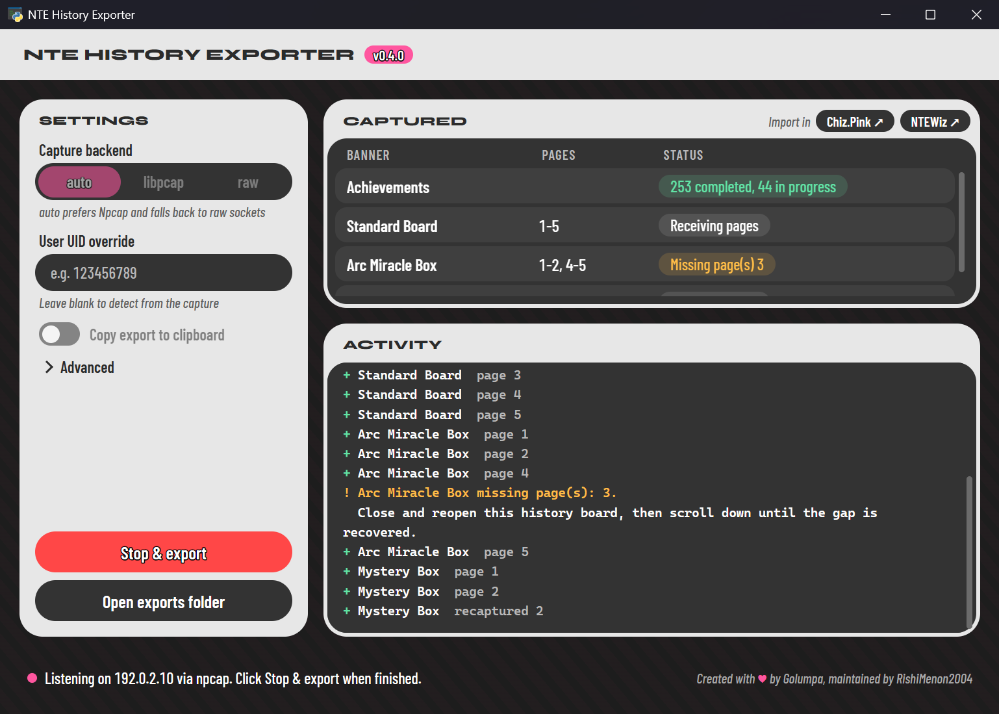

# NTE History Exporter

Export your **Neverness to Everness** pull history and achievements, and import
them into a tracker.

The exporter reads the game's own network traffic while you scroll through your
history boards in game, and saves what it sees as JSON files that trackers can
import. It never logs in to your account or changes anything in the game.

  

## Supported banners

| Banner | Kind |
| ------ | ---- |
| Standard Board | Monopoly |
| Limited Character Board | Monopoly |
| Arc Miracle Box | Gashapon |
| Mystery Box | Gashapon |

Achievements are exported too, both completed and in progress.

## Getting started

Download the latest exporter for your system:

| System | Download |
| ------ | -------- |
| Windows | [nte-history-exporter-gui.exe](https://github.com/RishiMenon2004/nte-exporter/releases/latest/download/nte-history-exporter-gui.exe) |
| Linux | [nte-history-exporter-gui-linux](https://github.com/RishiMenon2004/nte-exporter/releases/latest/download/nte-history-exporter-gui-linux) |
| macOS | `nte-history-exporter-gui-v<version>-x86_64-apple-darwin.zip` from the [latest release](https://github.com/RishiMenon2004/nte-exporter/releases/latest) |

Older versions and the command-line builds are on the
[Releases page](https://github.com/RishiMenon2004/nte-exporter/releases).

On Windows, install [Npcap](https://npcap.com/) first with its default options.
Then double-click the exe. It isn't code-signed, so Windows may warn you the
first time; choose **More info**, then **Run anyway**. Without Npcap it still
works, but you'll need to run it as administrator.

Linux and macOS need a little setup to allow capturing. See
[Running the downloaded builds](docs/gui.md#downloaded-builds) for the steps.

## Capturing your history

Start the exporter **before you press Start on the game's main menu**. Your
achievements, user UID and server are only sent while you log in. If you're
already in game, pull history still works, but you'll need to return to the main
menu and log in again for achievements.

Click **Start capture**, then open each history board in game and scroll down
through every page, starting from page 1. Pages appear in the exporter as they
arrive. When you're done, click **Stop & export**.

If a page is missed, the exporter tells you which one. Close and reopen that
history board in game and scroll down again; scrolling back up won't resend it.

It's worth scrolling one page further than you need. If you only want pages 1 to
5, scroll to page 6 as well.

## Importing into a tracker

After a capture, clicking **Chiz.Pink** sends the exports straight to Chiz.Pink and opens
its import page, so there are no files to drag. Mystery Box exports aren't sent,
because Chiz.Pink doesn't track them.

But clicking **NTEWiz** opens the site with the exports folder alongside it, ready to drag the
files in. Chiz.Pink does the same if there's no capture yet or sending fails.

Any other tracker that takes this format can import the files from the exports
folder. Each banner and your achievements are saved as separate files.

## Updates

When a newer release is out, a pill appears in the title bar. Clicking it
downloads the update, checks it against GitHub's checksum, then replaces the
exporter and restarts it.

## Privacy

The exports contain your pull history, your achievements and your NTE user UID.
They don't contain passwords, tokens, account or device IDs, IP addresses, or raw
network data. They can still identify your game account, so only share them with
trackers you trust.

When you send a capture to Chiz.Pink, the exports are encrypted on your computer
first. The key is only in the link that opens in your browser, which never sends
that part to a server. Chiz.Pink holds the encrypted copy until your browser
collects it, or for up to 10 minutes, then deletes it.

## Command line

There's also a command-line version, which runs the same capture in a terminal
and can replay saved captures. See [Command-line usage](docs/cli.md).

## For developers

| Guide | What it covers |
| ----- | -------------- |
| [Export format](docs/export-format.md) | The JSON files, pull IDs and achievement exports, for trackers importing them |
| [Direct import](docs/direct-import.md) | Letting the exporter send captures straight to your tracker |
| [Desktop GUI](docs/gui.md) | Running from source, how the app fits together, and customizing it |
| [Packaging](docs/packaging.md) | Building the executables |
| [Mapping updates](docs/mapping-updates.md) | Refreshing reward and achievement names from game data |
| [Capture diagnostics](docs/capture-diagnostics.md) | Debug output and replaying captures offline |
| [Packet format](docs/packet-format.md) | Notes on the decoded game traffic |
| [Limitations](docs/limitations.md) | What isn't supported yet |

Run from source with Python 3.10 or newer: `pip install -e ".[gui]"`, then
double-click `run-exporter-gui.cmd` on Windows or run
`python -m nte_history_exporter.gui`.

Don't commit packet captures, exports or personal account data. The `exports/`
folder is kept empty, and everything generated inside it is ignored.
