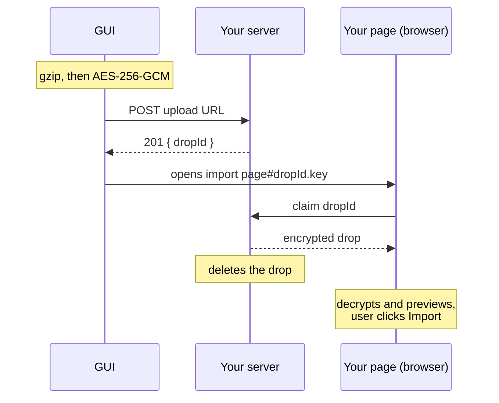

# Supporting direct import

This guide is for tracker sites that want to accept pulls straight from the NTE
History Exporter GUI. Normally the user downloads export files and drags them into
your import page. With direct import, the user clicks **Import in &lt;your site&gt;**
and the GUI sends the capture and opens your site on it, with no files involved.
The encrypted package it sends is called a drop.

Chiz.Pink is the working example. Its endpoint is `https://chiz.pink/api/import-drop`.

## How it works

The exporter can't sign in to your site, and your site may not have accounts at
all. So the GUI encrypts the capture, your server holds it for a few minutes, and
your page in the user's browser collects and decrypts it.



Your server only ever receives the encrypted drop, never the key, so it can't read
the pulls. The GUI puts the key in the link after the `#`, and browsers keep that
part of a link to themselves: it isn't sent when the page loads, so only your page's
script can read it. The drop ID goes after the `#` too, so it stays out of request
logs.

If anything goes wrong, nothing breaks. The GUI falls back to opening your site
with the exports folder, as it does for sites without direct import.

## Protocol (v1)

### What gets encrypted

All exports from the latest capture, one per banner, in one JSON document:

```json
{ "version": 1, "exports": [{ "format": "nte-history-export", "...": "..." }] }
```

Each item in `exports` is exactly what the exporter writes to an export file. See
[export-format.md](export-format.md). The JSON is compact, with no indentation.

A site can ask for some banners to be left out. For example, Chiz.Pink doesn't
receive Mystery Box exports. If every export is left out, no drop is sent.

### Encryption

1. UTF-8 encode the JSON and gzip it.
2. Generate a random 32-byte key and a random 12-byte IV.
3. Encrypt with AES-256-GCM. The 16-byte tag stays on the end of the ciphertext,
   which is what WebCrypto does by default.

### Upload

The GUI sends a `POST` with `Content-Type: application/json`:

```json
{ "version": 1, "ciphertext": "<base64>", "iv": "<base64>" }
```

Both values use standard base64, with padding.

| Status | Body | Meaning |
| ------ | ---- | ------- |
| 201 | `{ "dropId": "<id>" }` | Stored |
| 400 | `{ "error": "invalid" }` | Malformed, or an unknown `version` |
| 413 | `{ "error": "too_large" }` | Over your size limit |
| 429 | `{ "error": "busy" }` | Too many drops waiting |

The GUI only checks for 201 and reads `dropId`. Any other status, a network error
or no answer within 20 seconds makes it fall back to the folder. The error codes
above are a suggestion; you can add fields such as `expiresAt`.

The request comes from the GUI's local page, so the endpoint needs CORS. It must
answer the `OPTIONS` preflight and include these headers on every response:

```text
Access-Control-Allow-Origin: *
Access-Control-Allow-Methods: POST, OPTIONS
Access-Control-Allow-Headers: Content-Type
```

Allowing any origin is safe here, since no cookies or credentials are involved and
the body is already encrypted. Don't rely on an `Origin` value, because it differs
between platforms.

### Opening the page

The GUI then opens the user's default browser on:

```text
<import page URL>#<dropId>.<key>
```

The key is unpadded base64url. The drop ID must not contain a `.`.

## What your server needs

- **Random IDs.** Use a UUID or another unguessable ID.
- **Single use.** Delete the drop when the page claims it, so a reloaded or shared
  link finds nothing.
- **Expiry.** Delete unclaimed drops after a few minutes. Chiz.Pink uses 10, which
  covers a slow browser start.
- **A size limit.** Return 413 above it. Compressed drops are small: on Chiz.Pink,
  1,010 pulls across five banners came to 37.7 KB of ciphertext, about a tenth of
  the export files. A limit around 1 MB fits roughly 20,000 pulls.
- **A cap on stored drops.** The endpoint is open to anyone, so limit how many can
  wait at once and return 429 past that.

## What your page needs

1. Read the fragment, then remove it from the address bar and history straight
   away, for example with `history.replaceState(null, "", location.pathname)`.
2. Claim the drop from your server by ID.
3. Decrypt it in the browser. See the example below.
4. Show what will be imported and wait for the user to confirm. Without this, a
   crafted link could add pulls the user never chose.
5. If the link is invalid, expired or already used, say so and point to your
   normal file import.

Check that your analytics don't record the full URL, since they may load before
the page removes the fragment. With Vercel Analytics, for example, strip it in
`beforeSend`.

In React's development mode, effects run twice. Guard the claim so it happens
once, or the second attempt will find the drop already gone.

### Decrypting in the browser

```js
function fromBase64(value) {
  return Uint8Array.from(atob(value), (char) => char.charCodeAt(0))
}

function fromBase64Url(value) {
  const base64 = value.replace(/-/g, "+").replace(/_/g, "/")
  return fromBase64(base64.padEnd(Math.ceil(base64.length / 4) * 4, "="))
}

export function parseDropFragment(hash) {
  const [dropId, key, ...rest] = hash.replace(/^#/, "").split(".")
  return dropId && key && rest.length === 0 ? { dropId, key } : null
}

// drop is { ciphertext, iv } as uploaded. Returns the list of exports.
export async function decryptDrop(drop, key) {
  const cryptoKey = await crypto.subtle.importKey(
    "raw", fromBase64Url(key), "AES-GCM", false, ["decrypt"]
  )
  const compressed = await crypto.subtle.decrypt(
    { name: "AES-GCM", iv: fromBase64(drop.iv) },
    cryptoKey,
    fromBase64(drop.ciphertext)
  )
  const stream = new Blob([compressed])
    .stream()
    .pipeThrough(new DecompressionStream("gzip"))
  const payload = await new Response(stream).json()

  if (payload.version !== 1 || !Array.isArray(payload.exports)) {
    throw new Error("Unrecognised import format")
  }
  return payload.exports
}
```

A wrong or altered key makes `decrypt` throw. Treat that like an expired link.

Then import each export the way your file import already does.

## Testing without the GUI

This Node script (Node 18 or later) uploads an export file the way the GUI does
and prints the link to open:

```js
// Usage: node test-import-drop.mjs <upload URL> <import page URL> <export.json>...
import { webcrypto } from "node:crypto"
import { readFileSync } from "node:fs"
import { gzipSync } from "node:zlib"

const [uploadUrl, pageUrl, ...files] = process.argv.slice(2)

const plaintext = JSON.stringify({
  version: 1,
  exports: files.map((file) => JSON.parse(readFileSync(file, "utf8"))),
})
const keyBytes = webcrypto.getRandomValues(new Uint8Array(32))
const iv = webcrypto.getRandomValues(new Uint8Array(12))
const key = await webcrypto.subtle.importKey("raw", keyBytes, "AES-GCM", false, ["encrypt"])
const ciphertext = await webcrypto.subtle.encrypt({ name: "AES-GCM", iv }, key, gzipSync(plaintext))

const response = await fetch(uploadUrl, {
  method: "POST",
  headers: { "Content-Type": "application/json" },
  body: JSON.stringify({
    version: 1,
    ciphertext: Buffer.from(ciphertext).toString("base64"),
    iv: Buffer.from(iv).toString("base64"),
  }),
})
const result = await response.json()
console.log(response.status, result)

if (response.status === 201) {
  console.log(`${pageUrl}#${result.dropId}.${Buffer.from(keyBytes).toString("base64url")}`)
}
```

Before asking to be added, check that:

- [ ] The link shows the right banners and pull counts, and importing adds them.
- [ ] The `#...` part leaves the address bar as soon as the page loads.
- [ ] Reopening the link, or opening it after it expires, shows a clear message.
- [ ] A changed key shows that message too, without crashing.
- [ ] An oversized body gets 413.
- [ ] Your analytics show the page with no fragment.
- [ ] The production URL works, not only your dev server. Rewrites and proxies are
      the part most likely to differ.

## Getting your site added

The GUI's tracker buttons are listed in
[`src/nte_history_exporter/gui/trackers.py`](../src/nte_history_exporter/gui/trackers.py).
A site with direct import has a `drop` setting:

```python
"your_site": {
    "label": "Your Site",
    "url": "https://example.com/import",  # Opened with the folder as the fallback.
    "drop": {
        "upload_url": "https://example.com/api/import-drop",
        "open_url": "https://example.com/import/external",
        "skip_banners": (),  # Banner IDs your site doesn't take.
    },
},
```

To try it, add your entry with your dev server's URLs and run the GUI from source
(see [gui.md](gui.md)). After a capture, your button sends the drop. If it falls
back to the folder instead, the log says why.

When it works, open an issue or a pull request with the entry. Include your
production URLs and the privacy wording your site uses for drops.
