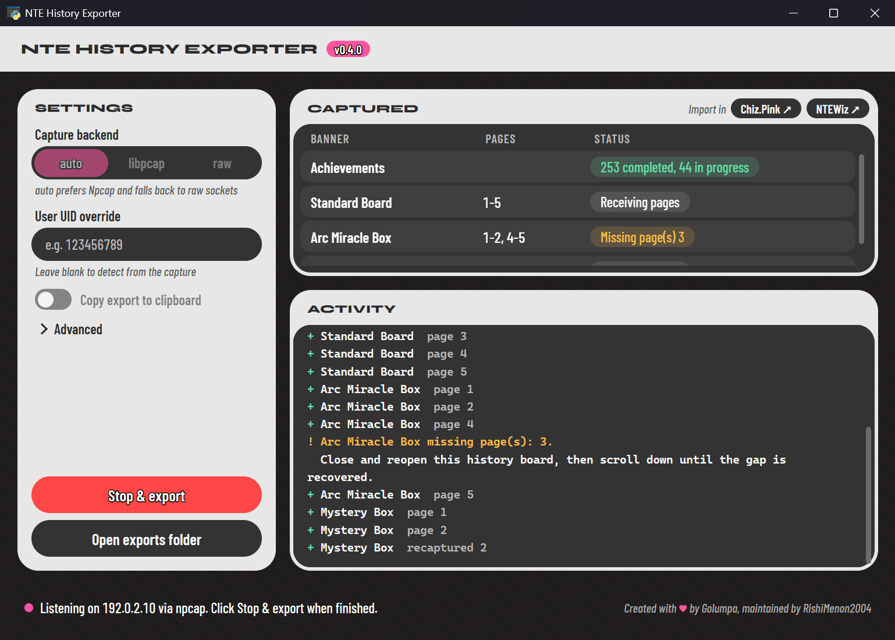

# Desktop GUI

The desktop GUI is an HTML/CSS page in a [pywebview](https://pywebview.flowrl.com/)
window, around the same live-capture code the CLI uses. The page runs in the
system's webview, and Python keeps the capture logic.



## Running it

### Downloaded builds

Each [release](https://github.com/RishiMenon2004/nte-exporter/releases) has a
GUI build for every platform. Packet capture needs the same permissions as the
CLI, which is where the platforms differ. The window also needs a webview:

| Platform | Webview |
| -------- | ------- |
| Windows | Microsoft Edge WebView2 Runtime. Included with Windows 11 and most updated Windows 10 installs; the app says so if it is missing. |
| Linux | WebKitGTK (`libwebkit2gtk-4.1`) from your distribution. |
| macOS | WKWebView, part of the system. |

**Windows**: [nte-history-exporter-gui.exe](https://github.com/RishiMenon2004/nte-exporter/releases/latest/download/nte-history-exporter-gui.exe)

- Double-click it. With [Npcap](https://npcap.com/) installed, no
  Administrator rights are needed.
- Without Npcap, `auto` falls back to raw sockets, which need Administrator.
  Right-click the exe and choose **Run as administrator**.
- The exe isn't code-signed, so SmartScreen may warn on first launch. Choose
  **More info → Run anyway**.
- Exports are written to `exports\` next to the exe.

**Linux**: [nte-history-exporter-gui-linux](https://github.com/RishiMenon2004/nte-exporter/releases/latest/download/nte-history-exporter-gui-linux)

```bash
chmod +x ./nte-history-exporter-gui-linux
```

Capture needs root or the raw-capture capabilities. Many desktops, and Wayland
in particular, refuse to show windows from apps run with `sudo`. So the
suggested route is to grant the capabilities to the binary once and then run it
as your normal user:

```bash
sudo setcap cap_net_raw,cap_net_admin=eip ./nte-history-exporter-gui-linux
./nte-history-exporter-gui-linux
```

This route hasn't been tested on every distribution yet. If it fails, run it
with `sudo -E ./nte-history-exporter-gui-linux` on an X11 session instead.
Exports go to `exports/` in the folder you started it from. If that folder
isn't writable, they go to `~/NTE History Exporter/exports/`.

**macOS**: `nte-history-exporter-gui-v<version>-x86_64-apple-darwin.zip` from the [latest release](https://github.com/RishiMenon2004/nte-exporter/releases/latest)

- Unzip it and move **NTE History Exporter.app** to Applications.
- The app isn't signed or notarized, so the first launch is blocked. Right-click
  it, choose **Open**, then **Open** again. Alternatively, clear the quarantine
  flag:
  `xattr -dr com.apple.quarantine "/Applications/NTE History Exporter.app"`.
- Capturing needs access to the BPF devices. The simplest option is to start
  the app as root from Terminal:

  ```bash
  sudo "/Applications/NTE History Exporter.app/Contents/MacOS/nte-history-exporter-gui"
  ```

  To launch it by double-clicking instead, give your user BPF access. Wireshark's
  installer adds a **ChmodBPF** helper that does this.
- Exports go to `~/Documents/NTE History Exporter/exports/`. The
  **Open exports folder** button opens it.

The builds are x86_64. On Apple Silicon Macs the macOS build runs through
Rosetta 2.

### From source

The CLI has no dependencies, but the GUI needs pywebview:

```bash
pip install -e ".[gui]"
```

On Linux that also builds PyGObject, which needs the GTK and WebKit development
packages. On Ubuntu:

```bash
sudo apt-get install libgirepository-2.0-dev libcairo2-dev pkg-config gir1.2-gtk-3.0 gir1.2-webkit2-4.1
```

| From | Command |
| ---- | ------- |
| Source checkout (Windows) | Double-click `run-exporter-gui.cmd` |
| Source checkout (any OS) | `PYTHONPATH=src python -m nte_history_exporter.gui` |
| Installed package | `nte-history-exporter-gui` |

From source, exports go to `exports/` under the working directory, the same as
the CLI. To build the packaged GUI yourself, see
[packaging.md](packaging.md#desktop-gui).

## How it fits together

```text
src/nte_history_exporter/gui/
  web/style.css  colors, fonts, sizes, shapes                <- start here for looks
  web/index.html page structure
  web/app.js     draws what the bridge sends, handles clicks
  web/fonts/     bundled Syne and Barlow Condensed, with their licences
  theme.py       every string shown in the window, window size
  trackers.py    tracker sites and what each one accepts
  self_update.py replaces the packaged program with a newer release
  app.py         Bridge (the page's API), capture thread, event handlers
  reporter.py    GuiReporter: turns runner output into queue events
  __main__.py    `python -m nte_history_exporter.gui`
```

`run_live_capture()` in `live_capture/runner.py` takes two optional arguments
that the CLI leaves at their defaults:

- `reporter`: an object with the same functions as the `console` module
  (`print_page_captured`, `prompt_user_uid`, ...). The CLI passes `console`;
  the GUI passes a `GuiReporter`.
- `stop_requested`: a callable polled for every packet or read timeout. The CLI
  uses the press-any-key monitor; the GUI passes `_stop_event.is_set`.

The flow from capture to screen:

1. Capture runs on a worker thread. `GuiReporter` turns each call into an event
   tuple such as `("page", "Standard Board", 3, False)` on a queue.
2. The page calls `pywebview.api.poll()` every 80 ms.
3. `Bridge.poll` drains the queue, calling the handler `_on_<event name>` for
   each event. Handlers keep the state (rows, page sets) and queue render
   operations: plain dicts such as `{"op": "row", "label": ..., "status": ...}`.
4. `poll` returns those operations, and the `ops` table in `web/app.js` draws them.

So decisions live in Python, where `tests/test_gui.py` can check them, and
`app.js` only draws. Prompts (missing UID/server) send a `PromptReply`; the
capture thread blocks on it until the page calls `answer_prompt`.

Every public method of `Bridge` can be called from the page. Names starting with
`_` are hidden from it, so keep helpers private.

## Customizing

Looks live in `web/style.css`; wording and window size live in `theme.py`. To see
a change, close and relaunch the window; there is no hot reload.

### Colors

Colors are CSS variables in `:root` at the top of `style.css`. Use the variables
rather than hex values in the rules below them.

| Token | Used for |
| ----- | -------- |
| `--pink` / `--pink-hover` | primary button, active controls, version pill |
| `--danger` / `--danger-hover` | Stop button |
| `--page` / `--stripe` | area behind the panels and its faint diagonal stripes |
| `--chrome` | title bar |
| `--panel` / `--on-panel` / `--on-panel-muted` | panels, and text on them |
| `--well` / `--on-well` / `--on-well-muted` | recessed areas: table, log, inputs |
| `--row` | captured-list rows |
| `--on-page` / `--on-page-muted` | status bar text |
| `--accent-text` | pink text on a well, adjusted for contrast |
| `--success` / `--warning` / `--error` | log lines and status badges |

### Fonts

Two families are bundled in `web/fonts/` and declared with `@font-face` at the
top of `style.css`: Syne for headings and Barlow Condensed for everything else.
The log uses the system's monospace font. To add a font, drop the file in
`web/fonts/`, add a `@font-face`, and include its licence if it needs one.

### Sizes and spacing

`--radius-panel`, `--radius-well`, `--gap`, `--page-padding` and `--titlebar-height`
are in `:root`. `theme.WINDOW` sets the initial and minimum window size. The webview
applies the OS display scale, so CSS pixels are the same at any scaling.

If you add text to the sidebar, check it at the minimum window size. The
`@media (max-height: 700px)` block tightens the sidebar to keep both buttons in
view there.

### Text

Every string the window shows is in `TEXT`: labels, hints, button captions,
status-bar messages, dialog prompts, and the "How to capture" steps shown in
the Activity panel while idle (`TEXT["instructions"]`, one entry per step).
Some strings take placeholders, such as `{ip}`, `{backend}`, `{count}` and
`{version}`. Keep those when you reword them.

In `index.html`, `data-text="key"` fills an element from `TEXT`. A test checks
that every key used by the page exists.

The results notes written after a capture (for example "No history pages were
captured.") come from `runner.py` and are shared with the CLI, so change them
there.

### Tracker buttons

The "Import in" buttons in the Captured header come from `trackers.SITES`. Add an
entry with a `label` and `url` to add a button. The page only passes the key, so
it can't open anything that isn't listed there.

Clicking one also opens the exports folder just after the site, so it lands on
top and a file can be dragged straight onto the page. On Windows it first asks
Explorer which folders are open and skips this if the folder is already there.
Other platforms have no such check, so they always ask the file manager to open
it.

An entry with a `drop` setting can take the latest capture directly instead. The
page encrypts the exports and uploads them, then the site opens on a one-time link,
with no folder needed. Mystery Box exports aren't sent, because the site doesn't
track them. With no capture yet, or if the upload fails, the button falls back to
the site and folder as above. Chiz.Pink is the only site that does this so far;
[direct-import.md](direct-import.md) explains how another site can support it. Set
`NTE_CHIZ_PINK_URL=http://localhost:3000` to point it at a local dev server.

### Updates

When GitHub has a newer release, a pill appears in the title bar. In a packaged
build, clicking it downloads that platform's file from the release, checks it
against the SHA-256 GitHub publishes, replaces the running program and starts the
new one. The logic is in `gui/self_update.py`, and `asset_name()` there has to match
the file names in `.github/workflows/release.yml`.

The pill just opens the release page when run from source, or if the release has no
file for this platform. A failed update, such as one in a protected folder, logs why
and does the same. It waits for a running capture, and only the GUI is replaced: a
CLI executable beside it keeps its version.

### Activity log colors

Each log segment is a `(text, tag)` pair, and the tag becomes a CSS class under
`.log`. To add a style, add a rule and use the tag in `app.py`:

```css
.log .highlight {
  color: var(--pink);
}
```

```python
# app.py, inside any handler
self._append(("Nice pull!", "highlight"))
```

`_append` takes any number of segments and writes them as one line, which is how
a single log line gets several colors.

## Going further

### Debugging the page

Pass `debug=True` to `webview.start` in `app.main` to open the browser dev tools
with the window.

### Moving things around

`.page` in `style.css` is a CSS grid holding the settings, Captured and Activity
panels and the status bar.

- Change `grid-template-rows` on `.page` to change how space is split between the
  Captured table and the Activity log.
- Add a setting by adding its input to `index.html`, sending its value from the
  `submit` handler in `app.js`, listing it in the `state` operation (so it locks
  during capture), and reading it in `Bridge.start_capture`.

### Reacting to a new kind of event

1. Add a method to `GuiReporter` that calls `self._emit("my_event", ...)`.
2. Add `_on_my_event(self, ...)` to `Bridge`. If it changes the screen, call
   `self._emit("my_op", ...)` and add `my_op` to the `ops` table in `web/app.js`.

If the runner should call it, add the same function to `console.py` too, so
the CLI keeps working with the default reporter. `tests/test_gui.py` shows how
to drive `run_live_capture` with a fake capture backend and check the events.

### Previewing without the game

You don't need live traffic to iterate on the look. Put events on the queue
yourself:

```python
import webview
from nte_history_exporter.gui import app

bridge = app.Bridge()
app._create_window(webview, bridge)
bridge.events.put(("listening", "192.0.2.10", "npcap", ""))
for page in range(1, 6):
    bridge.events.put(("page", "Standard Board", page, False))
bridge.events.put(("missing", "Arc Miracle Box", [3]))
bridge.events.put(("achievements", 212, 38, 41, 6))
webview.start(**app._start_options())
```

Run it with `PYTHONPATH=src`.
